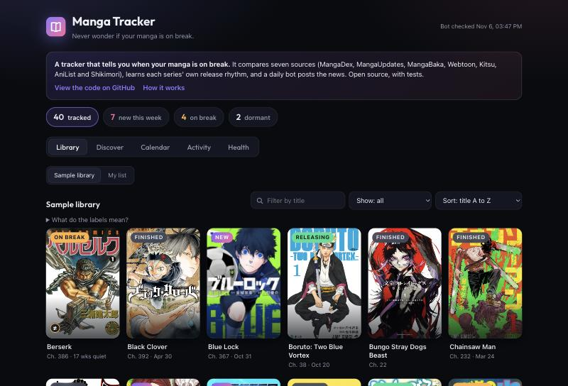
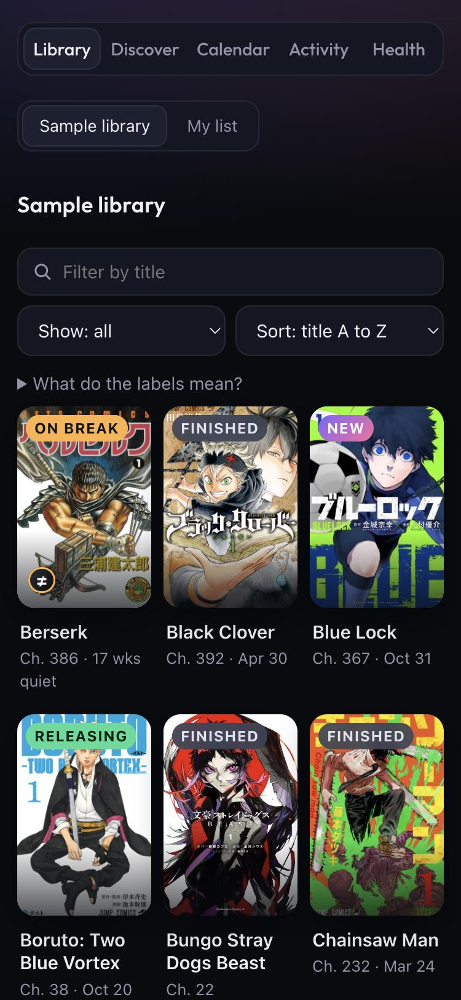
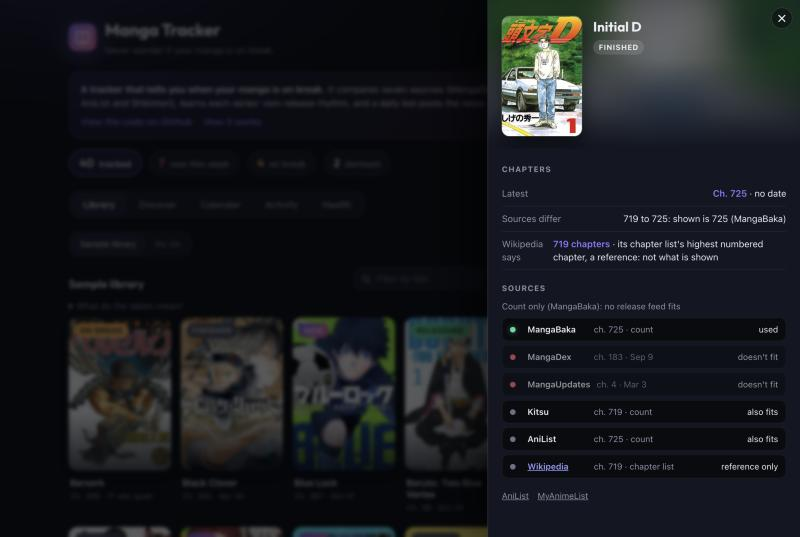

# Manga Tracker

[](https://github.com/SSY0ne/manga-tracker-webvers/actions/workflows/tests.yml)
[](LICENSE)

**Never wonder if your manga is on break.** MyAnimeList tells you what you read; it doesn't tell you when a series
went quiet. This does: it compares seven sources, learns each series' own release rhythm, and a daily bot posts
the news to Discord.

**[Live demo](https://ssy0ne.github.io/manga-tracker-webvers/)** · [How it works](docs/HOW_IT_WORKS.md)

<p>
  
  
</p>

## What it does

- **Tells you what is new, on break or dormant.** A series is "on break" when it is far more overdue than its own
  usual rhythm (a weekly one after 6 weeks, a monthly one after 90 days). "Dormant" means no chapter for 5+ years.
- **Compares seven sources** (MangaDex, MangaUpdates, MangaBaka, Webtoon, Kitsu, AniList, Shikimori) instead of
  trusting one, and says so when they disagree.
- **A daily bot** (GitHub Actions) checks everything, writes the results to the repo, and sends one Discord digest.
- **Discover and My list:** browse and search any manga, and keep your own list in the browser.
- **Honest about doubt:** a "≠ sources differ" mark, a per-source breakdown, and Wikipedia's chapter list as a reference.

<p>
  
</p>

## How it works

```
 MangaDex · MangaUpdates · MangaBaka · Webtoon · Kitsu · AniList · Shikimori
                                  │
                     reconcile()  (a few tested rules)
                                  │
                  ┌───────────────┴───────────────┐
             state.json                      Discord digest
                  │
        the web page (GitHub Pages)
```

Plain HTML/CSS/JavaScript on the front, Python (standard library only) on the back, no build step. The rules that
decide what the tracker tells you are covered by **169 tests**, including replays of recorded source answers for
78 series and checks against what the web says. Details: [docs/HOW_IT_WORKS.md](docs/HOW_IT_WORKS.md).

## Run it

```bash
python3 server.py          # then open http://127.0.0.1:8123
python3 -m unittest test_rules test_fixtures test_js test_reference
python3 check.py --dry     # what the daily bot would send, without sending
```

`server.py` makes you the **owner**: add and import series, set your reading progress, edit per-series settings.
On the published site everyone is a **visitor** (read-only, plus their own My list in the browser).

To get the Discord digest, add your webhook as the repo secret `DISCORD_WEBHOOK_URL`; the workflow in
`.github/workflows/check.yml` does the rest. Setup notes: [docs/HOW_IT_WORKS.md](docs/HOW_IT_WORKS.md#discord-alerts).

## Honest limits

- **Chapter counts of finished series can be off by a few.** The sources copy one upstream list that counts extras
  as chapters (Bleach 706, Wikipedia 686). The page flags it instead of pretending to be sure.
- **My list has one source for running series** (browsers can't call MangaDex or MangaUpdates), so it has no
  release dates and no alerts. It is a reading checklist, not a tracker.
- **It is built for one list.** The bot tracks the owner's series; there are no accounts.
- It relies on free, unofficial services that can change or disappear.

## Data and credits

Titles, covers and statuses come from [AniList](https://anilist.co/); chapters, counts and dates from
[MangaDex](https://api.mangadex.org/docs/), [MangaUpdates](https://api.mangaupdates.com/),
[MangaBaka](https://mangabaka.org/), [Kitsu](https://kitsu.docs.apiary.io/), [Shikimori](https://shikimori.one/api/doc)
and Webtoon's public RSS feeds; [Wikipedia](https://en.wikipedia.org/)'s chapter lists serve as a reference. Only
metadata and links to official pages are used. Covers belong to their publishers.

## License

[MIT](LICENSE) for the code in this repository.
